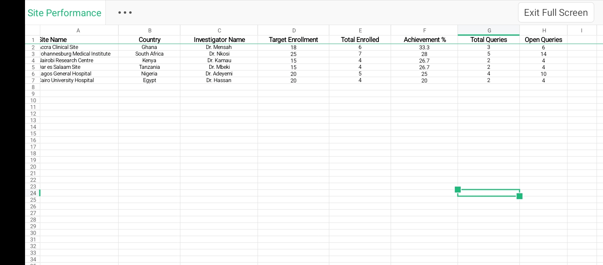

## Clinical Trial Site Performance Analysis

A clinical trial site performance analysis project using SQL, Excel, and Power BI to examine recruitment activity, site-level performance, and data-quality indicators across multiple clinical trial sites.

# Project at a Glance
Project Type: Independent clinical data portfolio project
Role: Clinical Data Analyst
Tools: MySQL, Excel, Power BI
Database: 3 related tables
Sites Analysed: 6 clinical trial sites
Primary Focus: Recruitment performance and data quality
Data: Simulated clinical trial data

## The Problem
Clinical trial teams need visibility into how individual sites are performing throughout a study.
Recruitment delays, incomplete records, inconsistent data, or differences between sites can affect study timelines and create additional data-management and monitoring requirements.

This project demonstrates how structured clinical trial data can be transformed into site-level performance insights using SQL and business intelligence tools.

# What I Built
I worked with a simulated clinical trial dataset containing information across multiple related tables and six study sites.

# The workflow covered:
Data → SQL analysis → Excel review → Power BI dashboard → Site-level insights

The analysis focused on:
- Recruitment activity
- Site performance
- Patient-level records
- Data-quality indicators
- Differences between clinical trial sites
- Potential areas requiring operational attention

## Data Structure
The project used three related tables to represent a simplified clinical trial data environment.

The relational structure allowed information to be combined and analysed across different aspects of study activity.

The dataset was designed for portfolio purposes and contains simulated information rather than real patient data.

# SQL Analysis

MySQL was used to query and analyse the underlying clinical trial data.

The analysis included tasks such as:
- Joining related tables
- Filtering study records
- Aggregating site-level data
- Counting records
- Comparing sites
- Identifying data-quality patterns
- Generating summary metrics

The SQL workflow demonstrates how clinical trial data can be queried before being transformed into reporting and dashboard outputs.

# Excel Analysis
Excel was used for additional data review and analysis.
The workflow included:
- Data checking
- Summary calculations
- Site-level comparisons
- Data-quality review
- Supporting analysis for dashboard development

Excel provided an intermediate layer between raw data and the final visualisation.

# Power BI Dashboard
The analysed data was transformed into a Power BI dashboard designed to provide a quick view of clinical trial site performance.

The dashboard focuses on:
- Recruitment performance
- Site comparisons
- Data-quality indicators
- Overall study-level patterns
The purpose of the dashboard is to make site-level information easier to interpret and support operational review.

## Project Preview

A screenshot from the Excel analysis is shown below.

## Full Project Files

The complete project materials are available in the project folder, including:

- SQL queries
- Excel analysis
- Power BI dashboard
- Supporting project files

[View the Full Project on Google Drive](https://drive.google.com/drive/folders/1j9DA1bGKlvtSlwac9kH_AxhEZWDKF2kb)

## Key Questions Explored
The analysis was designed around practical clinical trial operations questions, including:
- How are individual sites performing relative to the study?
- Which sites show differences in recruitment activity?
- Where are data-quality issues appearing?
- What patterns become visible when site-level records are aggregated?
- How can SQL results be transformed into a dashboard for easier operational review?

## Real-World Relevance
Clinical trial site performance data can support study teams in monitoring recruitment progress, identifying data-quality concerns, and understanding differences between sites.

From a clinical data perspective, combining structured querying with visual reporting can make large volumes of study information easier to review and communicate.

This project demonstrates my ability to connect:
Clinical research data → data querying → quality review → operational reporting

# Skills Demonstrated

- SQL / MySQL
- Relational data analysis
- Clinical trial data analysis
- Data cleaning and quality review
- Site-level performance analysis
- Excel
- Power BI
- Data visualisation
- Clinical data interpretation
- Operational reporting
- Structured problem solving

# Limitations
This is an independent portfolio project using simulated clinical trial data.
The dataset does not contain real patient information and should not be interpreted as a representation of an actual clinical trial.
The analysis is also simplified compared with the data environments used in production clinical research settings.

# Future Improvements
Future versions could include:
- Recruitment forecasting
- Site performance trend analysis
- Automated data-quality alerts
- Query management integration
- Additional clinical data domains
- Power BI drill-through pages
- Automated refresh workflows
- Risk-based site monitoring indicators

# Project Outcome
This project demonstrates how I can work across SQL, Excel, and Power BI to transform structured clinical trial data into practical site-level analysis and reporting.

It combines clinical research knowledge with data analysis and visualisation to support clinical trial operations and data-quality review.
